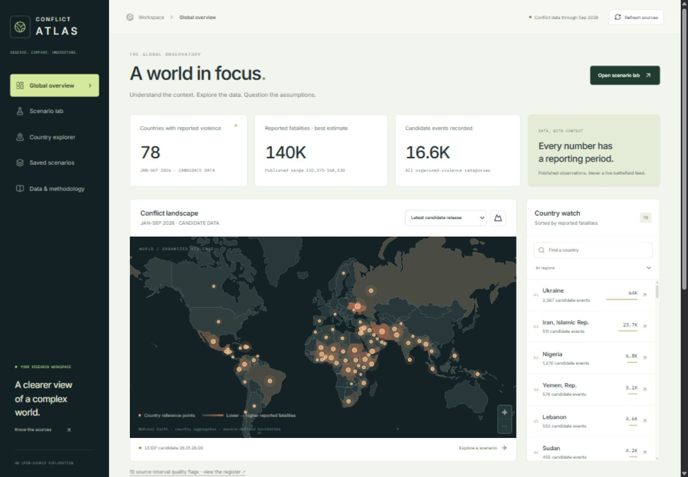
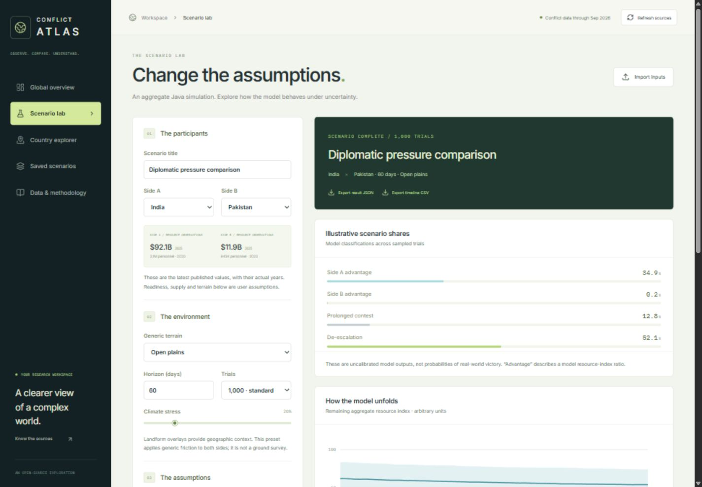

# Conflict Atlas

A map-based conflict observatory and reproducible country-resource scenario simulator. **Java 21 / Spring Boot** owns the simulation, validation, data refresh and persistence. **Svelte 5 / TypeScript / MapLibre** provide the interface. One executable JAR serves the complete application.

The [GitHub Pages edition](https://brocoder007.github.io/conflict-simuation/) provides the map, country profiles and dated snapshots. The Java application is needed for simulations, saved runs and automatic updates.



## What you can do

- Explore a country-level world map of published organized violence, with annual observations from **1989–2025** and a pinned **January–September 2026** candidate release.
- Filter by year and region, search countries, toggle major physical landforms and build a local watchlist. An SVG fallback supports devices without a working WebGL map.
- Inspect country histories, published fatality ranges and category breakdowns. Compare military expenditure, personnel, GDP and population, each with its actual observation year.
- Run seeded Java Monte Carlo scenarios with two countries, terrain presets, climate stress, readiness, supply and diplomatic assumptions. Inspect sampled trajectories and the model’s outcome classifications.
- Keep up to 50 runs in a browser-specific workspace, compare two runs, export results as JSON, export timelines as CSV and import scenario inputs for a new calculation.
- Read selected, dated **UN News** reports. Background updates refresh reporting and public resource indicators; provider failures retain the last successful data with visible freshness/error states.
- Inspect data-source receipts and source-quality flags. The snapshot contains **7,132 country-years**, **16,633 candidate events**, and **217 economies with at least one resource observation**. Missing observations are retained as missing.

This is an **educational aggregate model**, not a validated forecast of war outcomes. Spending and personnel are incomplete resource proxies; readiness and supply are user assumptions. Terrain presets apply generic friction, while map landforms provide geographic context. The project does not simulate actual front lines, routes, weapons employment, casualties or territorial gains. See [the model specification](docs/MODEL.md).



## Run from source

Requirements: **JDK 21+**, **Node.js 24 LTS**, Git. Maven is downloaded by the included official wrapper; no separate Maven installation, API key or database service is required for local use. Python 3.10+ is needed only for the snapshot checks/rebuild tool.

```sh
git clone https://github.com/BroCoder007/conflict-simuation.git
cd conflict-simuation/frontend
npm ci
npm run check
npm run build
cd ../backend
```

Windows PowerShell:

```powershell
.\mvnw.cmd clean verify
cd ..
java -jar backend/target/conflict-atlas.jar
```

macOS / Linux:

```sh
chmod +x mvnw
./mvnw clean verify
cd ..
java -jar backend/target/conflict-atlas.jar
```

Open **http://127.0.0.1:8080**. The application binds to loopback by default. Stop it with Ctrl+C. It creates a persistent H2 database at `data/conflict-atlas.mv.db` relative to the directory where you launch the JAR.

### Development

Run `./mvnw spring-boot:run` in `backend/` (`.\mvnw.cmd spring-boot:run` on Windows), then `npm run dev` in `frontend/`. Open the printed Vite address. The frontend proxies `/api` to the Java service, preserving same-origin form protection. Development from `backend/` stores its default database under `backend/data/`, separately from a JAR launched at the repository root.

### Windows Java networking

If a restricted or unusually long Windows temporary path produces `Unable to establish loopback connection`, create a short, writable temporary folder and launch with:

```powershell
java -Djdk.net.unixdomain.tmpdir=C:/path/to/short-temp -jar backend/target/conflict-atlas.jar
```

Use your own existing writable path. This was needed in the local managed test environment with JDK 25; it is not an application data directory.

## Using the workspace

1. **Observe:** select a published period or region on the overview. Map markers are country reference points, not event locations. Country names and boundaries follow the source conventions.
2. **Explore:** select a country or use Country explorer. Read the indicator years before comparing countries. For example, many personnel observations are from 2020; they must not be treated as current force totals.
3. **Experiment:** select two countries with positive published spending and personnel observations. Choose terrain and assumptions, then **Run & save scenario**. Every result retains its resolved resource inputs, observation years, seed and model version.
4. **Compare:** select two runs in Saved scenarios. Changing an input in the lab leaves the old result visibly marked until you run again.
5. **Export:** JSON preserves the result and source receipt. CSV exports the sampled timeline. Import loads inputs only and recalculates against the currently loaded data; it does not certify or restore imported results.

The workspace cookie is random and HttpOnly. Run records are scoped to that browser token, with a 30-day cookie lifetime. Clearing the cookie or switching browsers creates a different workspace; export work you want to keep. This is not an authenticated multi-user account system.

## Data and freshness

| Layer | Source / period | Update behaviour |
| --- | --- | --- |
| Historical organized violence | UCDP country-year 26.1, 1989–2025 | Bundled, pinned release |
| Recent organized violence | UCDP candidate 26.01.26.09, Jan–Sep 2026 | Bundled, pinned release; provisional |
| Military expenditure | World Bank / SIPRI, latest non-null observation | Refresh after 24 hours or manual request |
| Personnel, GDP, population | World Bank, latest non-null observation | Same refresh policy; years may differ |
| Current reporting | Official UN News RSS; headline topic filter | Refresh after startup and every 15 minutes |
| Boundaries / major landforms | Natural Earth 1:110m | Bundled; no tile service or map key |

**Refresh sources** updates reporting and resource indicators, not the pinned UCDP release. Refresh requests have a ten-minute cooldown. Headline filtering is a convenience, not a verified classification of current wars. Organized violence is broader than interstate war; the dashboard labels it accordingly.

The quality register identifies ten country-period aggregates with inconsistent published low/high intervals. Values are preserved and inconsistent annual bands are omitted from chart shading. See [sources, attribution and quality handling](docs/DATA.md).

To rebuild snapshots deliberately:

```sh
python scripts/refresh_data.py
python scripts/test_data.py
```

Then rebuild the frontend and JAR. `--reuse-downloads` reuses intermediate UCDP/geography downloads under ignored `work/`; reporting and resource observations are still fetched. Pinned release URLs, versions and periods must be changed together when adopting a newer UCDP release. Complete downloads/parsing precede output replacement; inspect tests and receipts before committing a new snapshot.

## Configuration and deployment

See [DEPLOYMENT.md](docs/DEPLOYMENT.md), [API.md](docs/API.md) and [SECURITY.md](SECURITY.md). `.env.example` documents runtime environment variables; Java does **not** automatically load that file.

H2 is the default for one local process. A PostgreSQL JDBC driver is included for a persistent database service. Use a dedicated database and environment-supplied credentials. The Dockerfile is an optional build recipe; GitHub CI produces the runnable Java 21 JAR.

## Verification

```sh
cd frontend
npm run check
npm run build
cd ../backend
# Windows: .\mvnw.cmd clean verify
./mvnw clean verify
cd ..
python scripts/test_data.py
python scripts/test_package.py
```

The suite covers seeded results, terrain sensitivity, diplomacy assumptions, sample-range invariants, missing resources, validation, browser-workspace isolation, CSRF rejection, persistence, secure RSS parsing, dataset contracts and byte-identical packaged assets. CI runs on Java 21 and Node 24. See [VALIDATION.md](docs/VALIDATION.md) for the actual local/browser checks and remaining verification limits.

## Code structure / OOP

```text
backend/src/main/java/io/conflictatlas/
  domain/       immutable records and validated scenario contracts
  engine/       Monte Carlo engine and sealed terrain strategy implementations
  data/         typed catalog, bounded source refresh and secure RSS parser
  persistence/  repository interface and JDBC implementation
  web/          REST controllers, workspace scoping and request protection
frontend/src/
  pages/        observatory, country explorer, lab, library and methodology
  components/   MapLibre/SVG map and accessible charts with table alternatives
scripts/        attributed data rebuilds and data/package contract checks
```

The Java engine is independent of the web controllers and database. `TerrainModel` demonstrates polymorphism through sealed strategy implementations; `RunRepository` separates storage from simulation. Composition and immutable records carry data and model receipts across layers.

## Licensing

Application code retains the repository’s [MIT licence](LICENSE). UCDP data is CC BY 4.0, Natural Earth is public domain, and World Bank indicators retain their source-specific terms. The small SIPRI-derived snapshot is supplied for this educational, non-commercial project; commercial use requires checking SIPRI’s terms. The code licence does not relicense bundled data. Full attribution is in [DATA.md](docs/DATA.md).
